# Cyber-Security-project

Project for the course Cyber Security Base 2026

## Running the app

### 1. Clone the repository

```bash
git clone https://github.com/<your-username>/Cyber-Security-project.git
cd Cyber-Security-project
```

### 2. Create and activate a virtual environment

```bash
python -m venv venv
# Windows:
venv\Scripts\activate
# macOS / Linux:
source venv/bin/activate
```

### 3. Install dependencies

```bash
pip install django
```

### 4. Build the database

If migrations and the database file aren't tracked in git, create them:

```bash
python manage.py makemigrations core
python manage.py migrate
```

Otherwise:

```bash
python manage.py migrate
```

### 5. Run the development server

```bash
python manage.py runserver
```

# LISTED SECURITY FAILURES

### 1. Broken Access Control

Problem: Identity of user is carried on a tamperable user_id cookie. Changing it makes you appear as another user.
Sub problem: No CSRF token on delete POST request. This is covered later in injection section.

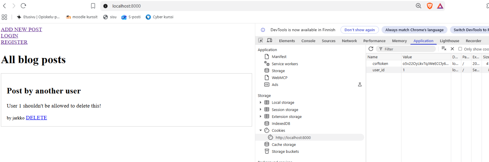

Changing directly from the browser allows user 1 to become user 2.

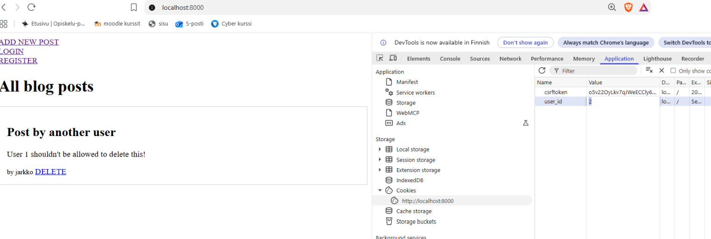

FIX: Used Djangos server side sessions. Now changing client-side cookie is rejected.

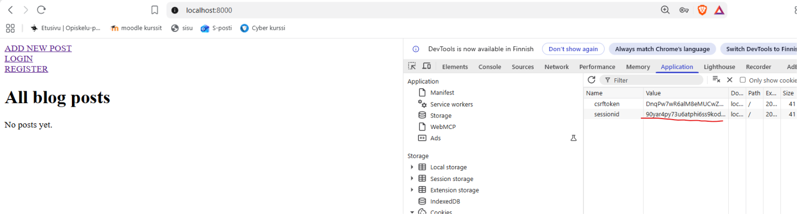

### 2. Cryptographic Failures.

Problem: Passwords are stored as plaintext in database. If a hacker gets them they immediately see passwords.

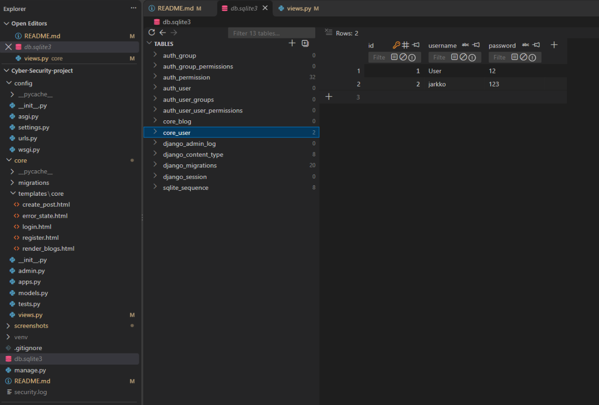

FIX: Using hashing on all passwords.

Now passwords are stored as hashses. Much more difficult to get through

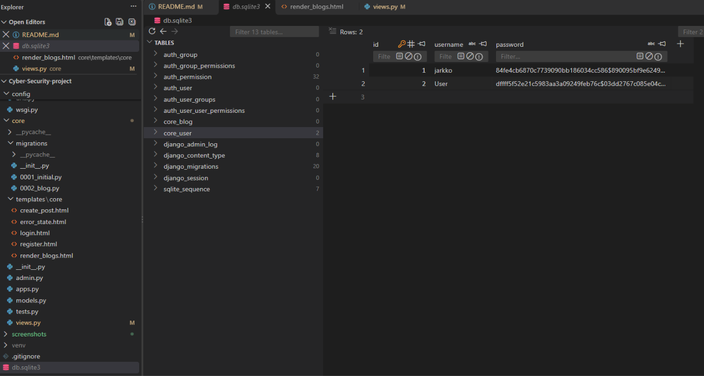

### 3. Injection.

Problem: Insecure query on logging in. Allows for SQL injections.

```python
with connection.cursor() as cursor:
            cursor.execute(
                f"SELECT id, password FROM core_user WHERE username = '{username}' LIMIT 1",
                [],
            )
            row = cursor.fetchone()
```

Before starting remember to create a user into the database with register.

Then go to login and do the following:

1. In username field write:' UNION SELECT 1, 'pw' --
2. In password field write: pw

   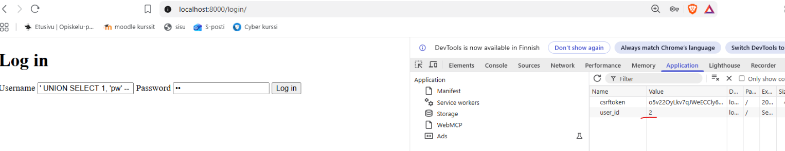

3. Press login

   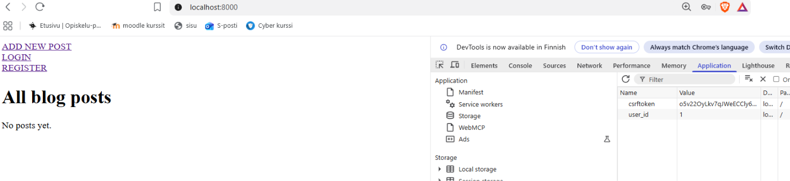

4. Now logged in

Also you can inject Scripts in to the post body since:

```html
<p>{{ blog.body|safe }}</p>
```

In this example User has created a blog post and jarkko has created a post with a xss script.
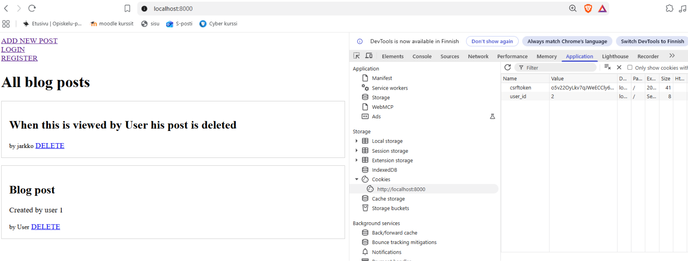

The hidden bodytext contains: <script>fetch('/posts/delete/3/')</script>
When the author of blog, with the id 3, views this script it automatically deletes his post.
(Sometimes requires a refresh!)
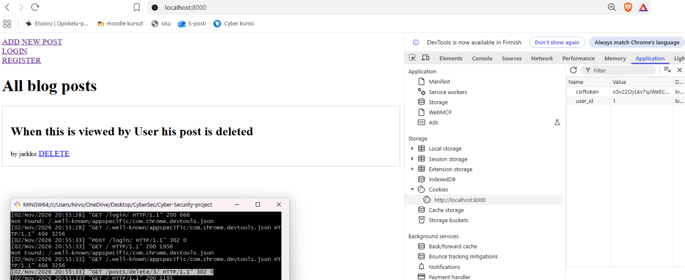

FIX(XSS): Remove the |safe tag. Change the GET method to POST so it has CSRF key included
After removing the safe tag. The body text isn't treated as a script and renders as text:

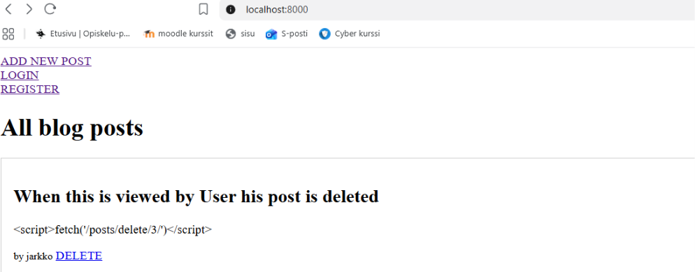

FIX(SQL): Parametrize the query so users can't inject anything in to it.
The new password rule already blocks this payload (the password pw is too short).
But even if you remove that rule, the parameterized query treats the whole input as a literal username, so the injection still fails,
which proves the parameterization is what actually fixes it.
But if we remove them for a test we find that injection no longer works.

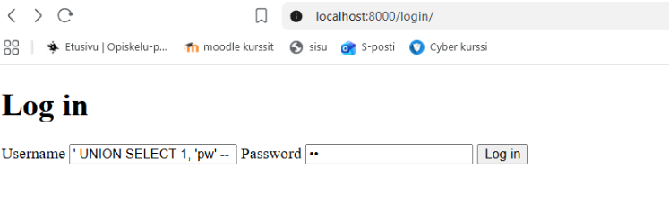

After pressing login the injection doesn't work.

You can see this by the fact that there is no session id on the image below.

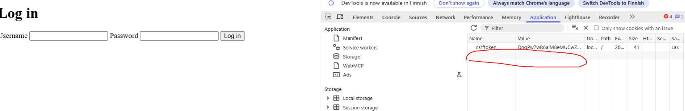

### 4. Identification & Authentication Failures

Problem: Insecure password allowed. Username enumeration is easy with distinct error messages for wrong password vs no user.

(To recreate this you need to have a user named admin and no user named None existent)
Example:
Username: None existent
Password: Password
Result:

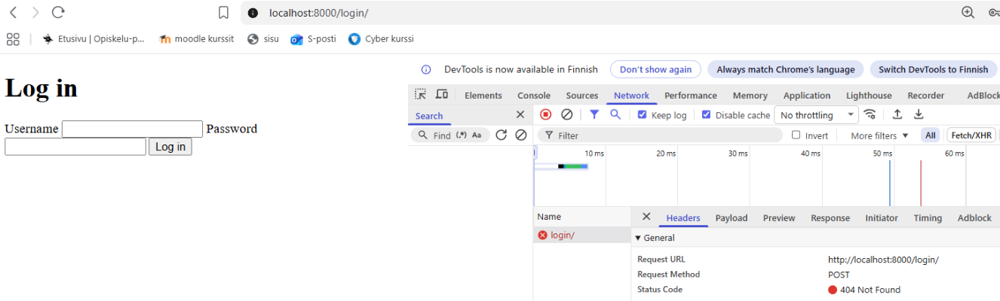

2nd Example:
Username: admin
Password: hmmmm
Result:

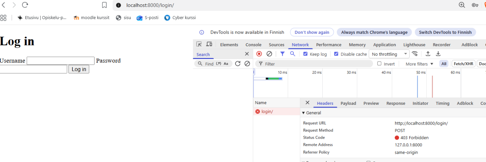

You can see here that someone who tries account usernames randomly will find which do exist.

FIX:

- Strict passwords required: +6 char and 1 digit.
- Hashing. (Covered in part 1)
- One generic not authorized instead of multiple.
- Timing equialization. (Hash a password even if user not found.)

1st example revisited with fix:

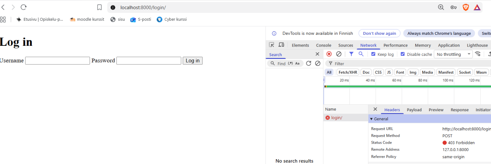

2nd example revisited with fix:

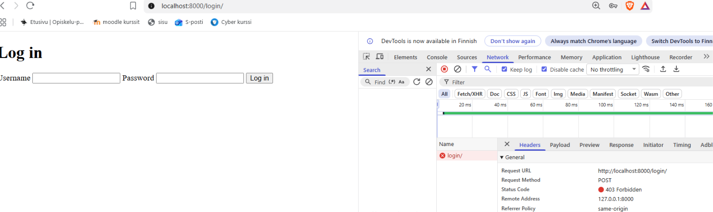

also showcasing the error given for weak passwords:
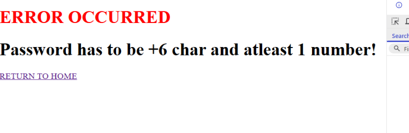

Now enumerating users is much harder

### 5. Security Logging & Monitoring Failures

Problem: Nothing logs to an external service. Only place to see failed logins or such is on the host console.
Logs also lack any relevant information like IP.

Here I have manually attempted to login multiple times and failing.
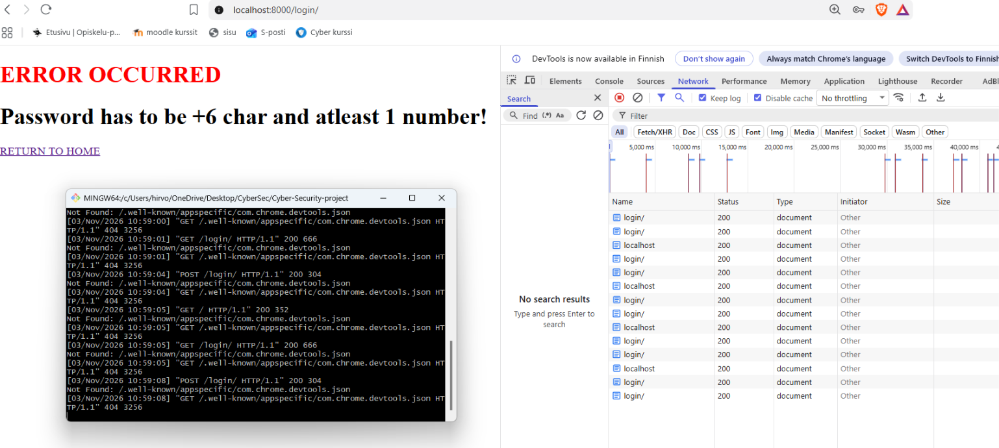

No record is kept of this interaction and if i were to do this with a dedicated software for bruteforcing there would be no trace left.

FIX: add logging that stores important details to a file. Ideally you would want to host another service like tracing to do this.
But for the purpose of this course it gets stored in security.log.

Now I will do the same after having turned on security_logger:
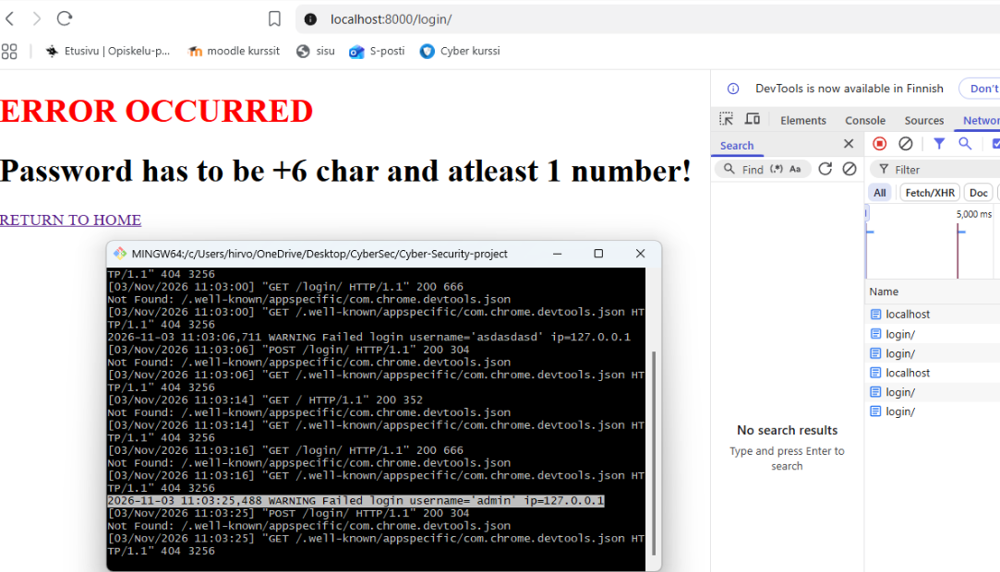

This log should also be sent to an external logging application or database.
Building a new application would be out of scope for this project, but I have represented this external application as a file.
This sample of the file came from testing the website naturally:

```
2026-09-30 14:04:16,099 WARNING Failed register username='NewAndCorrect' ip=REMOVED_FROM_SCREENSHOT
2026-09-30 14:12:59,279 INFO Successful login user_id=7 ip=REMOVED_FROM_SCREENSHOT
2026-09-30 14:13:23,033 INFO Successful login user_id=7 ip=REMOVED_FROM_SCREENSHOT
2026-09-30 14:13:23,110 WARNING Attempted to use incorrect method on delete: GET, ip=REMOVED_FROM_SCREENSHOT, post=5
2026-09-30 14:14:39,986 WARNING Attempted to use incorrect method on delete: GET, ip=REMOVED_FROM_SCREENSHOT, post=5
2026-09-30 14:15:31,577 WARNING Failed login username="' UNION SELECT 1, 'pw' --" ip=REMOVED_FROM_SCREENSHOT
2026-09-30 14:23:34,180 WARNING Failed login username='None existent' ip=REMOVED_FROM_SCREENSHOT
2026-09-30 14:30:48,418 WARNING Attempted to log to none existent user username='DOesnt Exist' ip=REMOVED_FROM_SCREENSHOT
2026-09-30 14:31:24,840 WARNING Incorrect password on login username='admin' ip=REMOVED_FROM_SCREENSHOT
```

- 2 Attempted incorrect method on delete come from the XSS script that was stored as a post.
- First failed login shows the username used in the SQL injection attempt.

Since this is still a part of the same program it is possibly vulnerable to being deleted by a party that gains access to it.
That should be fixed when creating production software.

### NOTES:

- There are 2 different registering systems and swapping them might make users created before to not work.
